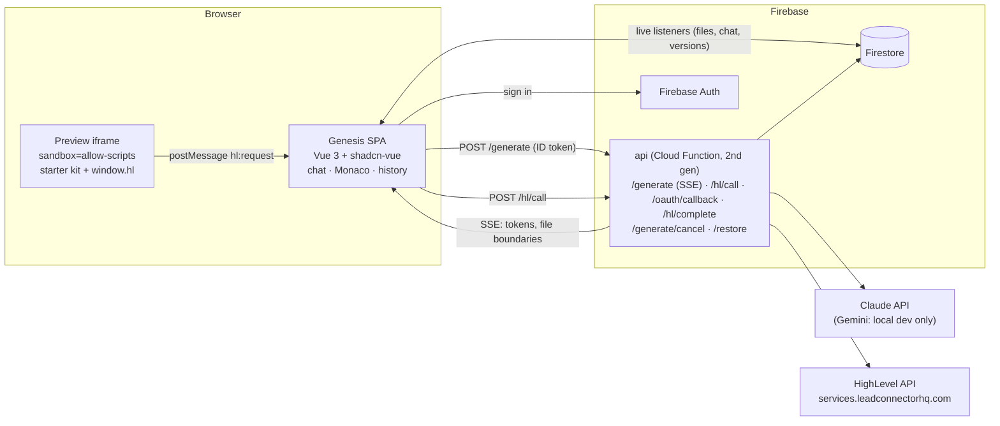
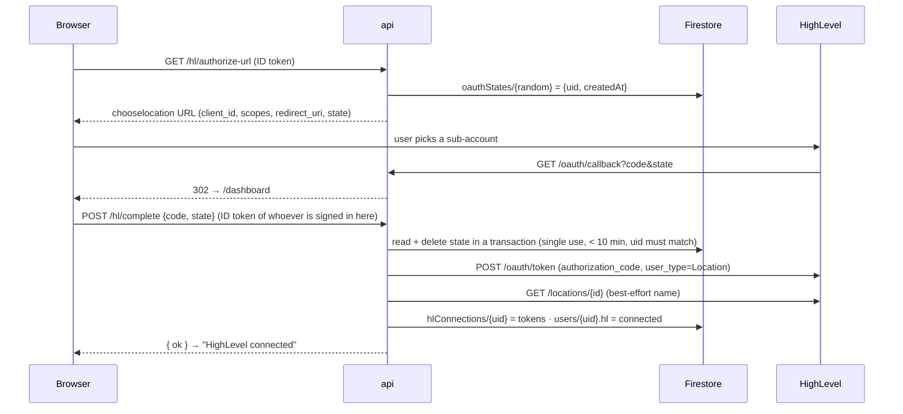
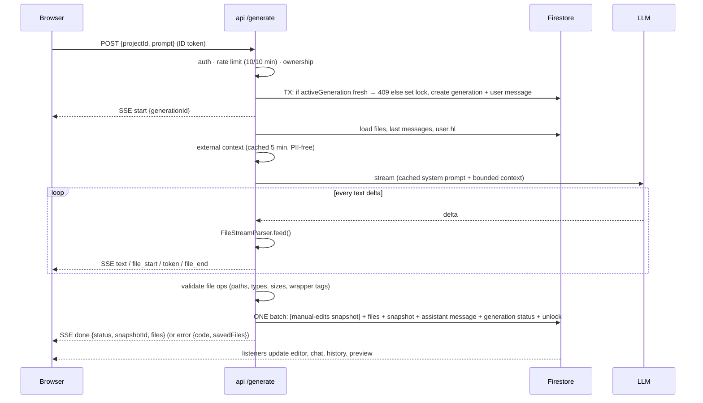
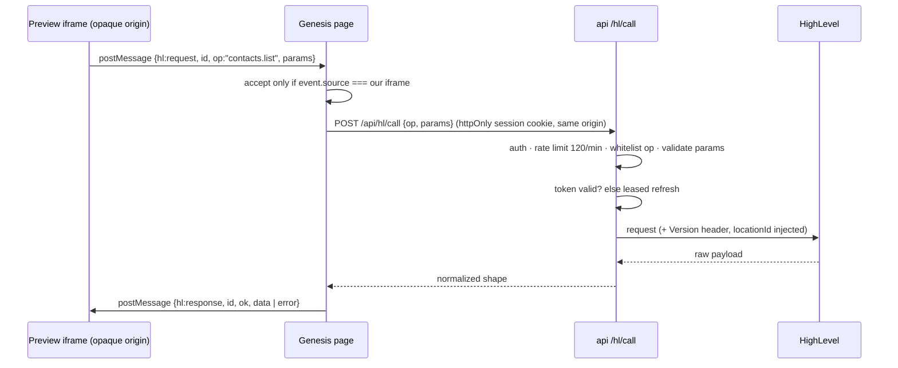

# Genesis: System Design

> An AI app builder that turns a chat prompt into a working HighLevel marketplace app, streamed live, previewed against real CRM data, and versioned.

**Contents:** 1 Goals · 2 Architecture · 3 Data model · 4 Key flows · 5 LLM pipeline · 6 Preview sandbox & starter kit · 7 Consistency & concurrency · 8 Failure handling · 9 Security · 10 Observability · 11 Performance & cost · 12 Scaling to 10k users · 13 Trade-offs · 14 Testing · 15 Future work

---

## 1. Goals and non-goals

**Goals**
- Prompt → working app in under a minute, with code visible as it is written (streaming).
- Generated apps use **real HighLevel data** (Contacts, Conversations, Calendars) without ever holding credentials.
- Every generation is **saved atomically and restorable**. Failures keep whatever finished.
- The system stays correct under double submits, closed tabs, expired tokens, model hiccups and malformed model output.

**Non-goals (for this version)**
- Per-app backends (webhooks, cron, own storage). Generated apps are frontends over a shared, safe data proxy.
- npm dependencies / bundling inside generated apps.
- Multi-user collaboration on one project.

---

## 2. Architecture



| Component | Responsibility |
|---|---|
| **Genesis SPA** | Auth screens, dashboard + HighLevel connection, 3-panel workspace. Reads saved state via Firestore listeners; renders in-flight generations from the SSE stream. |
| **`api` function** | One Express app on Cloud Functions 2nd gen (Cloud Run): streaming responses, 540 s timeout, concurrency 40, secrets from Secret Manager. |
| **Firestore** | Source of truth for projects, files, chat, snapshots, generation records, HighLevel tokens (server-only). |
| **Preview iframe** | Runs generated code in an opaque origin with a preloaded starter kit. Data only via `window.hl` → postMessage → parent → proxy. |
| **HighLevel** | Data layer for generated apps + OAuth provider. |
| **LLM** | Writes the app code; Claude in deployed environments. |

**Why one function, not many?** One cold start to warm, one URL to register as the OAuth redirect, shared middleware (auth, CORS, errors). Routes are thin; logic lives in `generation/`, `hl/` and `lib/` modules.

---

## 3. Data model

```
users/{uid}                         client: read own · server: write
  hl: { status: connected|expired|disconnected, locationId, locationName, connectedAt }

hlConnections/{uid}                 server only (no client rules)
  accessToken, refreshToken, expiresAt, locationId, companyId, scope, refreshLeaseUntil

oauthStates/{state}                 server only, single-use, 10-min TTL
  uid, createdAt

projects/{projectId}                client: create/read/soft-delete own · server: lock
  ownerId, name, description, locationId, deleted, createdAt, updatedAt
  activeGeneration: { id, startedAt } | null          ← per-project lock
  ├─ files/{encodeURIComponent(path)}   path, content, updatedBy: ai|user|restore, updatedAt
  ├─ snapshots/{id}                     files[{path, content}], label, status: complete|partial, prompt, generationId?, restoredFrom?, createdAt
  ├─ messages/{id}                      role: user|assistant|system, content, status, files[], deletedFiles[], warnings[], error, snapshotId
  └─ generations/{id}                   uid, prompt, status, cancelRequested, error, usage, metrics{ttftMs,durationMs}, warnings

rateLimits/{uid}_{bucket}           server only: fixed-window counters
```

**Design notes**
- **One doc per file:** keeps every write small and lets the editor listen to individual file changes. The path is URL-encoded into the doc id so `components/x.js` never creates a sub-collection.
- **Full-copy snapshots:** restore is a single read and a single batch. Size is bounded by a 450 KB project cap, which stays under Firestore's 1 MiB doc limit.
- **Generation records are separate from chat messages:** they hold operational data (status, cancel flag, metrics) that the UI and the cancel endpoint both need.
- **Composite index:** `projects (ownerId ASC, deleted ASC, updatedAt DESC)` for the dashboard list.

---

## 4. Key flows

### 4.1 Connect HighLevel (OAuth 2.0)



### 4.2 Generate (the core loop)



Cancellation runs out of band: `POST /generate/cancel` sets `cancelRequested`, and the generate handler's Firestore listener aborts the LLM stream. Any path still commits the files that finished.

### 4.3 Preview data call



---

## 5. LLM pipeline

**Output contract.** The model writes plain text plus `<file path="…">…</file>` and `<delete path="…"/>` blocks. I chose this over JSON or tool calls because:
- tags stream naturally into the editor;
- the parser is incremental and tolerant of tags split across tokens;
- a broken stream still yields every *completed* file. Half-streamed JSON is unusable, and one bad escape invalidates everything.

**Edits instead of rewrites.** For changes to existing files the model writes `<edit path="…">` with `<search>`/`<replace>` pairs (`edits.ts`). Output tokens are the slow, expensive part, so re-sending a 600-line file to change a few lines was the main cost driver.

```
model ─▶ <edit app.js> search/replace × n ─▶ apply in order ─┬─ all match ─▶ whole new file ─▶ validate ─▶ save
                                                             └─ any miss ──▶ ONE follow-up call: "re-send app.js in full"
                                                                               ├─ got it ─▶ save
                                                                               └─ no ────▶ file untouched, EDIT_FAILED (retryable)
```

- **Exact match first, then line-trimmed match** (models drift on indentation). A search that matches twice is rejected; we never guess.
- **Atomic per file.** If any edit to a file fails, none of its edits apply. Found in testing: a half-applied edit added a toggle's state but not its button, so the app ran with the feature silently missing.
- **Bounded fallback.** At most one extra call, and only for the failed files. The rest of the pipeline only ever sees whole files.
- **Measured** with Gemini on the same refinement: whole-file rewrite 6.8k output tokens / 32 s, edits 3.8k / 25 s. Edit outcomes are logged per generation (`metrics.edits: applied / failed / repaired`).

**Context assembly (bounded).**

| Part | Budget | Placement |
|---|---|---|
| System prompt: rules, starter-kit API, shadcn recipes, `hl` contract | static | top-level `system`, **prompt-cached** |
| Chat history | last 6 messages | alternating turns |
| Project files | 160k chars, `index.html`/`app.js` first; overflow listed by name + user warned | final user turn |
| External context | ≤ 10 calendars, contact count, ≤ 12 tags, timezone. **No contact PII** | final user turn |
| Request | ≤ 4,000 chars | final user turn |

**The `hl` contract.** The model never sees raw HighLevel endpoints. It codes against 11 normalized operations (`spec.ts`), which keeps the context small, prevents invented URLs, and absorbs API quirks server-side.

**Validation (model output is untrusted input).**
- **Paths:** relative, ≤ 3 levels deep, safe characters, extension allow-list.
- **Content:** non-empty, ≤ 120 KB per file, ≤ 25 files and ≤ 450 KB per project.
- **Repairs:** markdown fences and stray `<script>`/`<style>` wrappers are stripped.
- **Partial rejection:** each failure is rejected individually, so one bad file never discards the rest.

**Model settings.**
- Claude Opus 5.5 at `effort: medium`, adaptive thinking, `max_tokens` 32k, server-side refusal fallback. If a fallback re-runs the request, a `reset` event clears the partial output.
- The model is configurable (`LLM_MODEL`). Sonnet 5.5 roughly halves cost.

---

## 6. Preview sandbox and starter kit

- **Isolation:** iframe of `/preview.html` (the parent posts it the built app) with `sandbox="allow-scripts allow-forms allow-modals allow-popups"`. There is **no** `allow-same-origin`, so generated code runs in an opaque origin and cannot read the parent's DOM, storage, cookies or Firebase session.
- **Build:** local `<script src>`/`<link>` are inlined in order. `</script>` inside code is escaped. Missing references are reported in the UI.
- **Starter kit:** every preview preloads these, with pinned versions:
  - Vue 3.5.44
  - Tailwind 4.3.3 (browser build) with **shadcn theme tokens identical to Genesis**
  - lucide icons via `<g-icon>`
  - `genesis.useHl()`: `{data, loading, error, reload}`, drops stale responses
  - `genesis.errorText()` and date/initials formatters
- **Effects of the kit:** in testing, output dropped from 14–23k to about 8k tokens, apps match the builder's look, and loading/error/empty states are uniform.
- **Duplicate libraries:** if the model adds Vue or Tailwind itself, the tag is stripped. Two Vue instances would silently break reactivity.
- **Own CSP, not `srcdoc`:** a `srcdoc` document inherits the Genesis page's strict CSP, and generated apps need inline scripts and runtime template compilation. `/preview.html` allows those but sets `connect-src 'none'` and no remote `img-src`, and the iframe has no `allow-popups`, which closes the easy ways for app code to send data out (see §9 for what remains).
- **Remounting:** the iframe is keyed by a content hash, so every render starts from a fresh `/preview.html`.
- **Runtime errors:** `error` and `unhandledrejection` inside the preview are posted to the parent and shown as a banner. The HL-calls panel lists every proxied call with status and latency.

---

## 7. Consistency and concurrency

| Concern | Mechanism |
|---|---|
| Double submit / two tabs | `activeGeneration` set inside a Firestore **transaction**. A second request gets `409`. The lock auto-expires after 10 min (function timeout is 9) so a crashed instance can't wedge a project. |
| Snapshot ≠ files | Files, snapshot, messages, generation status and unlock commit in **one batch**. |
| Manual edit vs AI write | Security rules reject file updates while the project is locked. The UI blocks sending while edits are unsaved. Saved hand edits are snapshotted as **"Manual edits"** before an AI overwrite or restore. |
| Restore during generation | Restore endpoint returns `409` while locked. Restore itself creates a snapshot, so it's undoable. |
| HighLevel refresh tokens rotate | Refresh runs under a 20 s Firestore **lease**. Concurrent callers wait and re-read instead of spending the single-use token. On 401 mid-call: force one refresh, retry once. |
| Search-as-you-type races (generated apps) | `useHl` sequence numbers drop stale responses. |
| Stream drop vs "no changes" | A stream that ends without a finish signal is an error, never a silent success. |

---

## 8. Failure handling

**Error taxonomy.** Every API error is `{ code, message, retryable }`. Codes:
- **Client and auth:** `UNAUTHENTICATED`, `SESSION_REQUIRED`, `RECENT_SIGN_IN_REQUIRED`, `FORBIDDEN`, `NOT_FOUND`, `BAD_REQUEST`, `RATE_LIMITED`, `GENERATION_IN_PROGRESS`, `EXPIRED_STATE`, `OAUTH_STATE_MISMATCH`
- **LLM:** `LLM_RATE_LIMITED`, `LLM_UNAVAILABLE`, `LLM_CONNECTION`, `LLM_CONFIG`, `LLM_REFUSED`, `TIMEOUT`, `CANCELLED`, `EDIT_FAILED`
- **HighLevel:** `HL_NOT_CONNECTED`, `HL_RECONNECT`, `HL_FORBIDDEN`, `HL_RATE_LIMITED`, `HL_TIMEOUT`, `HL_UNAVAILABLE`, `HL_BAD_PARAMS`, `HL_UNKNOWN_OP`, `HL_NEEDS_LOCATION`
- **Server:** `SAVE_FAILED`, `INTERNAL`

The UI keys its behaviour off `code` and `retryable` (a Retry button, a reconnect prompt, a re-login).

**Principles**
1. **Keep partial work.** Completed files are saved as a `partial` snapshot on any failure.
2. **Server outlives the client.** A closed tab doesn't cancel a paid generation. The UI enters `recovering` and resolves from Firestore when the lock clears. If the instance itself dies, the lock is never cleared, so server, rules and UI all treat a lock older than 10 minutes as stale (`lib/lock.ts` mirrors `STALE_LOCK_MS`); a scheduled sweeper that marks orphaned generations `failed` is the production follow-up.
3. **Retry only where it's safe.**
   - **LLM:** the Anthropic SDK retries twice with exponential backoff and jitter, before the first token only, so output is never duplicated. A refusal falls back to another model server-side (`reset` event).
   - **HighLevel:** 429/5xx/timeouts retry twice with exponential backoff and **full jitter** (random wait in `[0, base·2^n]`), honouring `Retry-After` (`hl/retry.ts`). Only GETs and search POSTs retry: repeating `contacts.create` or `sendMessage` after a timeout could duplicate the contact or the SMS, so writes fail fast until calls carry idempotency keys. Calendar fan-out is capped at 3 concurrent requests (HighLevel's burst limit is per location).
4. **Best-effort enrichments never block.** The external context and location name lookups are time-boxed and optional.
5. **No queue, so no DLQ yet.** A generation runs inside its request. A failed run is still durable: the generation doc keeps `status`, error `code`, usage and the prompt, and partial files are saved, so failures can be queried and replayed by hand. With a queue (Cloud Tasks) the production shape is: retries with backoff → dead-letter topic → alert + a replay tool.

The README has the full failure → UX → data table.

---

## 9. Security

| Threat | Control |
|---|---|
| Unauthenticated / cross-user access | Firebase ID token on every API call (revocation checked on `/generate`, OAuth and disconnect). Ownership check returns `404` for "missing or not yours". Firestore rules scope every client read and write to the owner. |
| Token theft via generated code | Tokens live in a server-only collection. The iframe has no same-origin access. The proxy injects the token server-side. |
| Abuse of HighLevel through the proxy | 11 whitelisted operations, typed param validation (ids regex-checked before URL interpolation), whitelisted writable contact fields, `locationId` injected (never taken from the client), 120 calls/min/user. |
| OAuth CSRF / replay / forged install link | Random single-use `state` (10-min TTL, redeemed in a transaction). The callback doesn't finish the install: it hands code+state to the Genesis tab in the URL fragment, and `/hl/complete` requires the signed-in user to be the one who started it, so a link generated by an attacker's account can't attach a victim admin's location to the attacker. |
| Cost abuse of the LLM key | 10 generations / 10 min / user, prompt ≤ 4k chars, `max_tokens` cap, hard 8-min abort. |
| Malicious or broken model output | Path and type allow-list, size limits, no server execution of generated code, sandboxed preview. |
| Secrets in source | Secret Manager (`ANTHROPIC_API_KEY`, `HL_CLIENT_SECRET`); `.env*` gitignored; `.env.example` documents names only. |
| Data sent to the LLM | Only schema-level HighLevel facts (calendar names, tags, counts). No contact names, emails or phones. |
| Prompt injection via CRM data | CRM records never enter the prompt (see above). The user's own prompt only influences sandboxed frontend code. |
| XSS on the Genesis page (script could act as the user) | **CSP** (meta tag, `vite.config.ts`): only our own bundle runs (no inline, no CDN); `connect-src` limited to our API + Firebase, so a token can't be sent elsewhere. Monaco is bundled locally, so **no third-party script runs on our origin**. Vue escapes all rendered text. `frame-ancestors 'self'`, `nosniff`, HSTS headers. |
| Stolen ID token used against the CRM | `/hl/call` accepts only an **httpOnly, Secure, SameSite=Strict session cookie** (`__session`), not the ID token. Minted only within 5 min of a real sign-in, verified with revocation on every call, `Origin` checked (CSRF). Same-origin via the Hosting rewrite `/api/**`. |
| Prompt injection via CRM data (a tag or calendar name written as instructions) | CRM values reach the prompt only through `crmLabel`: one line, no `<>`/backticks/control chars, ≤60 chars, JSON-quoted. The system prompt says `<highlevel_account>` and the location name are data, never instructions. No contact PII or free text (notes, messages) is ever put in the prompt. Whatever the model then writes still runs in the sandbox with only allowlisted `hl` operations. |
| Generated app exfiltrating CRM data | `/preview.html` has its own CSP: `connect-src 'none'` (no fetch/XHR/WebSocket) and `img-src data: blob:` (no image or CSS `url()` beacons); the iframe has no `allow-popups`; `form-action 'none'`. Data only flows in through `window.hl`. (srcdoc was dropped because it inherits the parent's CSP.) **Residual:** the frame can still navigate itself to a URL carrying data (CSP `navigate-to` never shipped in browsers) and WebRTC isn't governed by CSP. So this contains buggy code, not deliberately hostile code; full containment needs the preview on a separate origin behind a server-side egress proxy, plus confirmation before CRM writes. |
| Tampered CDN file in the preview | Starter-kit scripts are pinned and loaded with **SRI** hashes; a modified file is refused. |

Verified in the browser: an injected inline script, a script from an unknown domain, a `fetch` to an outside server from the app and from the preview are all blocked, and `document.cookie` does not expose the session.

**Auth model: why not a full BFF.** The ideal is a backend-for-frontend: no tokens in JavaScript, server sessions, all data access server-side. Firebase's design is that the browser talks to Firestore directly, which needs the ID token in the browser, and our live UI (chat, files, history, disconnect recovery) is built on those listeners. A full BFF would mean proxying every read and rebuilding live updates as server push. So: keep the client SDK for the user's own Genesis data (scoped by security rules), put the **CRM**, the high-value capability, behind the httpOnly cookie, and block XSS with CSP. Remaining exposure: a live XSS or malicious extension can act as the user while the page is open (true of any web app, BFF included); a stolen ID token alone can read/write that user's own Genesis projects.

**Known gaps (documented):**
- Tokens are not additionally encrypted at rest (KMS envelope encryption is planned).
- Rate limiting is per instance plus Firestore, not a global token bucket.

---

## 10. Observability

- **`generation_finished` structured log** per run: `projectId`, `generationId`, `status`, `errorCode`, `files`, `ttftMs`, `durationMs`, token `usage`. The same metrics are stored on the generation doc.
- **Warnings** for HighLevel API errors (path, status, detail) and failed token requests. Errors use stack-bearing `logger.error`.
- **In-product debugging:** the HL-calls panel (op, status, latency) and the preview runtime-error banner.
- **Prompt version per generation:** `promptVersion` (first 8 hex of the system prompt's SHA-256) is stored on every generation and in eval reports, so a quality or cost shift can be traced to the exact prompt change.
- **Confidence score per generation** (`generation/confidence.ts`): 0–100 from checks that need no extra model call: status, cut-off files, missing local files, made-up `hl` operations, blocked browser APIs, missing error handling, failed or repaired edits, validation warnings. Stored on the generation and the chat message, sent in `done`, logged in `generation_finished`. The chat shows "Check preview" / "Likely broken" with the reasons when it isn't high. We don't ask the model to rate itself: self-reported confidence is poorly calibrated. The eval suite calibrates this score (§14).
- **Dashboards to add (Cloud Logging → log-based metrics):**
  - p50/p95 time to first token and duration
  - failure rate by `errorCode`
  - partial-save rate
  - tokens per generation (cost)
  - HighLevel 429/5xx rate

---

## 11. Performance and cost

| Lever | Effect |
|---|---|
| Prompt caching of the static system prompt | Cheaper input, faster first token on every generation after the first |
| Cache breakpoint at the end of the conversation | Repair calls (failed edit, syntax error) read the whole project + history from cache (~10% of input price). Follow-ups miss, since the files changed |
| Starter kit | ~40–65% fewer output tokens (measured with Gemini: 14–23k → 8.3k) |
| Search/replace edits for changes | Refinements send only changed lines (measured: 6.8k → 3.8k output tokens, 32 s → 25 s) |
| External-context cache (5 min, keyed by user + location) | Follow-up prompts skip 3 HighLevel calls (up to 4 s) |
| SSE heartbeats every 10 s | Proxies don't close the stream during model thinking |
| `concurrency: 40` per instance | Long-lived streams share instances instead of scaling 1:1 |
| Preview renders saved files only | No re-render storms from half-written code during streaming |

**Approximate cost per generation:** Opus 5.5 is about $0.15–0.25 (8–10k output tokens at $20/M plus a small input). Sonnet 5.5 is about half. Firebase cost at demo scale is about $0.

---

## 12. Scaling to 10k users (~50k generations/day)

**Load model:**
- Peak around 5–10 generations/s.
- Each SSE stream lasts about 30–60 s, so roughly 300–600 concurrent streams.
- Each generation does about 10 Firestore writes plus the preview's HighLevel calls.

| Bottleneck | Today | At scale |
|---|---|---|
| **LLM rate limits (tokens/min)** | Direct call per request | A **queue** (Cloud Tasks / Pub/Sub) in front of the LLM, with per-tenant fairness and a priority tier for paying agencies. The client still streams, via the next row. Use Sonnet for small edits, Opus for new apps. |
| **Stream durability** | SSE tied to one instance; reconnect waits for the final save | Workers publish tokens to Redis Streams / Pub/Sub. `/generate/stream?from=offset` lets any instance resume a stream, so live tokens survive a reconnect. |
| **Compute** | Cloud Run, concurrency 40, max 10 instances | Concurrency about 80 (streams are I/O-bound), max instances sized to peak streams (600 / 80 ≈ 8, plus headroom). Keep min instances warm to avoid cold starts. |
| **HighLevel API limits** | Per-call proxy | HighLevel enforces per-location burst and daily limits. Add a short-TTL response cache for list reads, request coalescing, and exponential backoff with `Retry-After`. |
| **Snapshot storage** | Full copies in Firestore | Content-addressed blobs in Cloud Storage. The snapshot becomes a manifest of `{path → hash}`, so unchanged files are stored once. This also lifts the 450 KB project cap. |
| **Firestore hot spots** | Per-project lock doc | Fine: writes are per project, so traffic spreads naturally. Rate-limit counters move to Redis or Memorystore. |
| **Multi-region** | `us-central1` / `nam5` | Region-pinned functions per geography. The LLM call dominates latency anyway. |

---

## 13. Trade-offs and alternatives

| Decision | Chosen | Alternative | Why |
|---|---|---|---|
| Streaming transport | SSE via `fetch` + reader | WebSocket; `EventSource` | One-way stream; Cloud Functions can't hold WebSockets; `EventSource` can't POST or send auth headers |
| Output format | `<file>` tags | JSON / tool calls | Streams naturally; partial output salvageable |
| Changing existing code | `<edit>` search/replace, full-file fallback | Always rewrite; unified diffs; line numbers | Fewer output tokens; search text survives line shifts, unlike line numbers; unified diffs are brittle for models to write |
| Context for large projects | Send all files (capped) + prompt caching | RAG over embeddings; agentic `read_file` | Apps are capped at 25 files / 450 KB so everything fits; code relevance follows imports, not text similarity. Path: file map + `read_file` tool, embeddings only at 1000s of files |
| Data access from generated code | postMessage bridge + server proxy | Token in iframe; per-app backend | Credentials never reach untrusted code; no server-side execution of AI code |
| Preview runtime | Sandboxed `/preview.html` + starter kit | Sandpack / WebContainers | Instant, no bundler, no COOP/COEP; kit restores consistency |
| Snapshots | Full copies | Diffs / git-like | Simple, O(1) restore; scale path documented (§12) |
| Browser auth | Firebase ID token in browser + httpOnly cookie for CRM calls + CSP | Full BFF with server sessions | Keeps realtime Firestore listeners; the CRM is cookie-only; CSP blocks the XSS that would steal anything. Full BFF is the production target (§9) |
| Database | Firestore | Supabase / Postgres | Ships with Auth + Functions; live listeners power the UI; relational joins not needed |
| Generated-app framework | Vue 3 (CDN) | React | Matches HighLevel's own stack; no build step |

---

## 14. Testing

| Layer | What | Count |
|---|---|---|
| Unit: backend | Stream parser at every chunk size (1–1000 chars) incl. `<edit>` tags, search/replace apply (exact, indentation drift, `$` literals, ambiguity, all-or-nothing), file validation and repairs, HighLevel operation param validation + normalization + fallbacks, HighLevel retry (jittered backoff, Retry-After, reads only, concurrency cap), confidence score, JS syntax check, external-context summary (incl. no-PII check) | 73 |
| Unit: frontend | Preview builder (inlining, ordering, kit injection, duplicate-Vue stripping, `</script>` escaping, missing files), SSE event parser | 11 |
| End-to-end (emulators, mock LLM + mock HighLevel) | Security rules, OAuth, proxy, SSE protocol, partial save, lock (409), edits blocked mid-generation, cancel, client disconnect still saves, restore, soft delete, manual-edit snapshot, edit applied in place, failed edit repaired by one full-file call, unrepairable edit → `EDIT_FAILED`, session cookie (httpOnly/Secure/Strict, ID token alone rejected, forged cookie rejected, cross-site Origin rejected), OAuth callback finishes only in the signed-in tab (state from user A rejected for user B, single use) | 53 checks |
| **Evals** (`evals/`, real model, mock HighLevel) | 15 cases: 9 new apps, 3 refinements (edits), 3 negative (HighLevel down, prompt injection asking for `fetch`/`localStorage` exfiltration, unsupported delete). Each is graded by generation status, static checks, and a **headless-Chrome render of the real preview build** (no runtime errors, `hl` calls succeed, content rendered) into a 0–100 health score. Reports TTFT/duration p50/p95, tokens, $/case, and a **calibration table** (server confidence bucket vs. how often the app really works). See `evals/README.md` and `evals/results/latest.md`. | 15 cases |
| Manual (Chrome) | Full UI flow with a real model (Gemini locally); Claude before release | n/a |

`MOCK_LLM` / `MOCK_HL` exist for the emulator only. The `gemini` provider is refused outside the emulator.

---

## 15. Future work

1. Resumable streams (§12) and a generation queue.
2. **Self-repair loop:** feed preview runtime errors and failed `hl` calls back to the model automatically when confidence is low, and measure the lift with the eval suite.
3. KMS envelope encryption for HighLevel tokens.
4. Webhooks: HighLevel events (e.g. `ContactCreate`) pushed into running previews.
5. **Scaling the AI context** (today: every request sends all files, ≤160K chars, which suits 3–10-file apps). Move up a stage only when the trigger fires, and gate each stage on the eval suite (pass rate must not drop; input tokens and TTFT should).

   | Stage | Trigger | What changes |
   |---|---|---|
   | 0. Cache breakpoint on the conversation | Done | Repair calls read project + history from cache. Follow-ups miss because generations change the files; caching them would need the files placed before history and a stable order. |
   | 1. File map + `read_file` tool | Project > ~40K tokens, or files start being omitted | Send a **file map** (path, one-line summary, exports/globals; regenerated on save) plus the always-relevant files: entry files (`index.html`, `app.js`), files edited in the last few turns, files named in the prompt. The model calls `read_file(path)` for anything else (agentic retrieval, max ~5 reads). Edits stay search/replace, so output stays small. |
   | 2. Dependency-aware preselection | Hundreds of files | Build an **import/usage graph** on save (which file defines and uses which component or global). For a request, start from the files it names or that match, expand one hop through the graph, and send those plus the map. Code relevance follows imports, so this beats text similarity. |
   | 3. Embedding retrieval (RAG) | Thousands of files, or vague requests that the graph can't anchor | Embed files/functions on save (store in Firestore vector search), retrieve top-k for the request, merge with graph neighbours, then `read_file` as in stage 1. |
   | 4. Planner + parallel workers | Large multi-module apps (independent screens) | A planner splits the change into independent modules; workers edit them in parallel with the map as shared contract; a final pass checks cross-file names (and the verify-and-fix loop runs the app). Only when modules are truly independent, otherwise coordination costs more than it saves. |

   Cross-cutting: summarise chat history beyond the last 6 turns instead of dropping it; keep `omittedFiles` visible to the model so it never edits code it hasn't seen (already enforced for repairs).
